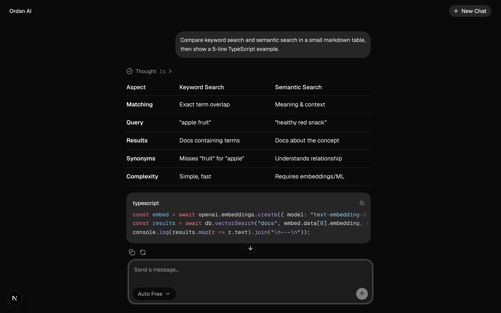

# Ordan AI

An AI engineering playground inspired by ChatGPT, Claude and Copilot.

The goal is not to build another chatbot. The chat is the test bench: each phase adds one AI engineering concept to it, measures the effect, and documents what was learned.



## What it explores

- Prompt engineering
- Retrieval augmented generation (RAG) and advanced RAG architectures
- NLP pipelines: chunking, embeddings, semantic and hybrid search
- Conversation memory
- Tool calling and agents
- Multi-model routing
- Caching and cost optimization
- Evaluation systems

## Roadmap

### Current features

- Chat interface built with shadcn/ui AI Elements
- Streaming responses
- Reasoning display, when the model shares its thinking
- Markdown, tables and highlighted code blocks
- Model picker, with copy and retry on each reply
- Versioned prompt library with a prompt picker: zero-shot, structured, few-shot and step by step
- Side-by-side prompt comparison
- Follow-up suggestions, generated as structured output
- Light and dark themes

### Upcoming features

- Saved conversation history
- Basic RAG
- Hybrid search
- Semantic caching
- Multi-model routing
- Agent workflows
- Long-term memory
- Evaluation framework

The full plan, phase by phase, is in [docs/roadmap.md](docs/roadmap.md).

## Stack

- [Next.js](https://nextjs.org) and TypeScript
- [shadcn/ui](https://ui.shadcn.com) and its [AI Elements](https://ui.shadcn.com/docs/ai-elements) patterns for every piece of AI UI
- Tailwind CSS
- [AI SDK](https://ai-sdk.dev) for streaming and message types
- [Kilo AI Gateway](https://kilo.ai/docs/gateway) for every model call

## Getting started

You need Node.js 20 or later, pnpm, and a Kilo API key.

```bash
pnpm install
```

```bash
cp .env.example .env.local
```

Set `KILO_API_KEY` in `.env.local`, then start the app:

```bash
pnpm dev
```

Open http://localhost:3000.

| Command          | What it does                  |
| ---------------- | ----------------------------- |
| `pnpm dev`       | Start the dev server          |
| `pnpm build`     | Build for production          |
| `pnpm typecheck` | Check types                   |
| `pnpm lint`      | Run ESLint                    |
| `pnpm format`    | Format the code with Prettier |

## Project structure

```
app/              Routes only. Pages and API handlers stay thin.
components/ui/    shadcn/ui components, added with the shadcn CLI.
components/       App shell: header, theme.
features/         One folder per feature. Each can be built and tested alone.
  chat/           The chat UI and its message parts.
  prompts/        The versioned prompt library.
  suggestions/    Follow-up questions after each reply.
  compare/        Side-by-side prompt comparison.
lib/ai/           The Kilo provider and the model list.
docs/             Architecture, roadmap, and one write-up per phase.
```

See [docs/architecture.md](docs/architecture.md) for how the pieces fit and how to add a feature.

## Documentation

- [Architecture](docs/architecture.md)
- [Roadmap](docs/roadmap.md)
- [Phases](docs/phases)

## Credits

The chat started from the [shadcn/ui chatbot template](https://github.com/shadcn-ui/chatbot-template) (MIT).

## License

Apache 2.0. See [LICENSE](LICENSE).
