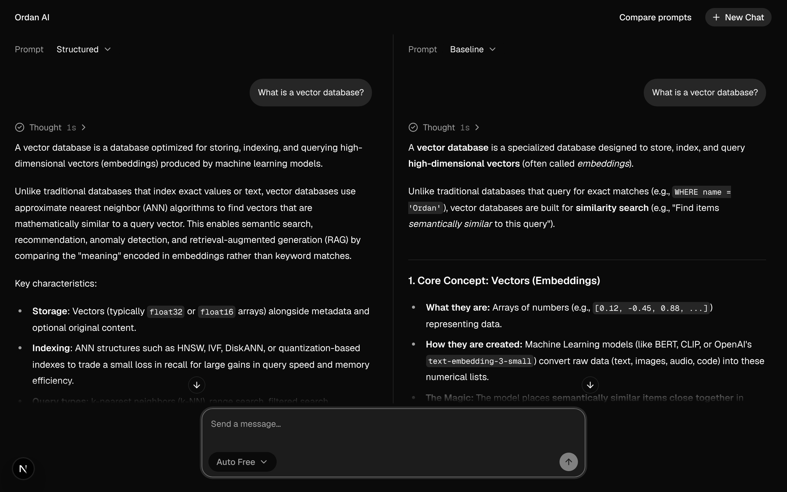
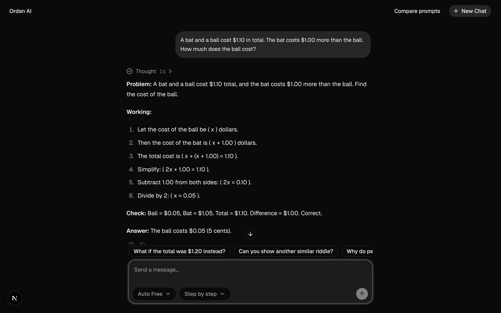

# Phase 1: Prompt engineering

**Status:** Done

## Goal

Make the prompt a first-class, versioned part of the app instead of one hard-coded string, and make it easy to see how a change in the prompt changes the answer.

## Concepts

- **System prompt.** The instructions the model gets before the conversation. It sets the role, the rules and the output format. It is the cheapest way to change how a model behaves.
- **Zero-shot prompting.** Asking for what you want with instructions only and no examples. The `baseline` prompt is zero-shot.
- **Role, context and tagged sections.** Telling the model who it is, who it is talking to, and what the situation is, with each kind of information in its own tagged section so the model does not mix them up. The `structured` prompt does this.
- **Prompt templates.** A prompt with `{{variables}}` that are filled in at request time. The `structured` prompt uses `{{date}}`, so the model knows today's date.
- **Few-shot prompting.** Showing the model examples of the input and the output you want. Examples teach a format better than a description of it. The `few-shot` prompt sends two example exchanges as earlier turns of the conversation.
- **Chain of thought.** Asking the model to work through a problem in steps before it answers, which improves accuracy on reasoning tasks. The `step-by-step` prompt does this and keeps the working separate from the answer.
- **Sampling temperature.** A setting that controls how random the output is. Low values give focused, repeatable answers. Higher values give more varied ones. Each prompt can set its own.
- **Structured output.** Making the model return JSON that matches a schema, so code can use the result as data. Follow-up suggestions use this.
- **Prompt versioning.** Every prompt has an id and a version number. A change in wording is a new version, so a result can always be traced to the exact prompt that produced it.

## What was built

### Prompt library: `features/prompts/`

| File                        | Purpose                                                                       |
| --------------------------- | ----------------------------------------------------------------------------- |
| `types.ts`                  | The shape of a prompt: id, version, technique, system text, examples, temperature. |
| `library/baseline.ts`       | The phase 0 prompt, kept as the control.                                      |
| `library/structured.ts`     | Role, context and rules in tagged sections. The default.                      |
| `library/few-shot.ts`       | A tutor whose answer format is taught by two examples.                        |
| `library/step-by-step.ts`   | Chain of thought with a separate final answer.                                |
| `build.ts`                  | Fills in template variables and turns examples into conversation turns.       |
| `index.ts`                  | The list of prompts. The first one is the default.                            |

To add a prompt, create a file in `library/` and add it to the list in `index.ts`. It then shows up in both pickers.

### Follow-up suggestions: `features/suggestions/`

After each reply, the app asks the model for three follow-up questions and shows them as one-click buttons above the input, using the shadcn/ui Suggestion pattern.

- `generate.ts` calls the model with a Zod schema through the AI SDK's `Output.object`, so the result is a typed list of strings.
- `prompt.ts` holds the instructions.
- `app/api/suggestions/route.ts` is the endpoint. `use-follow-ups.ts` calls it when a reply finishes, and `follow-ups.tsx` renders the buttons.

Suggestions are optional. If the call fails, the chat shows nothing and carries on.

### Compare page: `features/compare/` and `/compare`

One input sends the same message to two prompts and shows the replies side by side. Each side has its own prompt picker.

### Changes to the chat

- The prompt form has a prompt picker next to the model picker. The chosen prompt id is sent with each message.
- `app/api/chat/route.ts` looks up the prompt, builds it, and puts the few-shot examples before the real messages. An unknown prompt id is rejected.
- The message list moved into `chat-thread.tsx` so the chat and the compare page share it.
- The provider now sends JSON schemas to the gateway (`supportsStructuredOutputs`), so structured output is enforced by the model provider and not only requested in text.

## Results

Checked by hand with `kilo-auto/free`. These are observations from single runs, not measurements.

| Test                                              | Observation                                                                                                  |
| ------------------------------------------------- | ------------------------------------------------------------------------------------------------------------ |
| "What is a vector database?" on the compare page  | `structured` answered in the first sentence and stayed in prose with a short list. `baseline` produced a longer answer with numbered sections and heavy bold text. |
| "What is an embedding?" with `few-shot`           | The reply used the four parts from the examples (one line, analogy, example, check yourself) with no format instructions in the system prompt. |
| Bat and ball problem with `step-by-step`          | The reply restated the problem, showed the working, checked it, and gave the correct answer of $0.05.        |
| Follow-up suggestions, 4 calls                    | Each call returned exactly 3 questions that matched the schema.                                              |

## What I learned

- Examples control format more reliably than descriptions. The few-shot prompt has one sentence of instructions and still gets a strict four-part layout.
- Short, specific rules change behaviour. "Answer the question in the first sentence" visibly changed how replies open.
- Models that reason on their own already think before answering, so chain of thought prompting mostly changes how the answer is laid out, not whether the model reasons.
- Comparing by eye does not scale. Judging whether one prompt is better than another needs a fixed set of test questions and a score, which is the evaluation phase.

## Known limits

- There are no automated tests or scores. Comparison is by eye.
- Follow-up suggestions add one extra model call per reply.
- Prompts live in code. Editing one in the browser is not supported.
- The compare page does not keep its conversations, like the chat.

## References

- [AI SDK: prompt engineering](https://ai-sdk.dev/docs/ai-sdk-core/prompt-engineering)
- [AI SDK: generating structured data](https://ai-sdk.dev/docs/ai-sdk-core/generating-structured-data)
- [shadcn/ui Suggestion pattern](https://ui.shadcn.com/docs/ai-elements/base/suggestion)
- Wei et al., [Chain-of-Thought Prompting Elicits Reasoning in Large Language Models](https://arxiv.org/abs/2201.11903), 2022
- Brown et al., [Language Models are Few-Shot Learners](https://arxiv.org/abs/2005.14165), 2020
