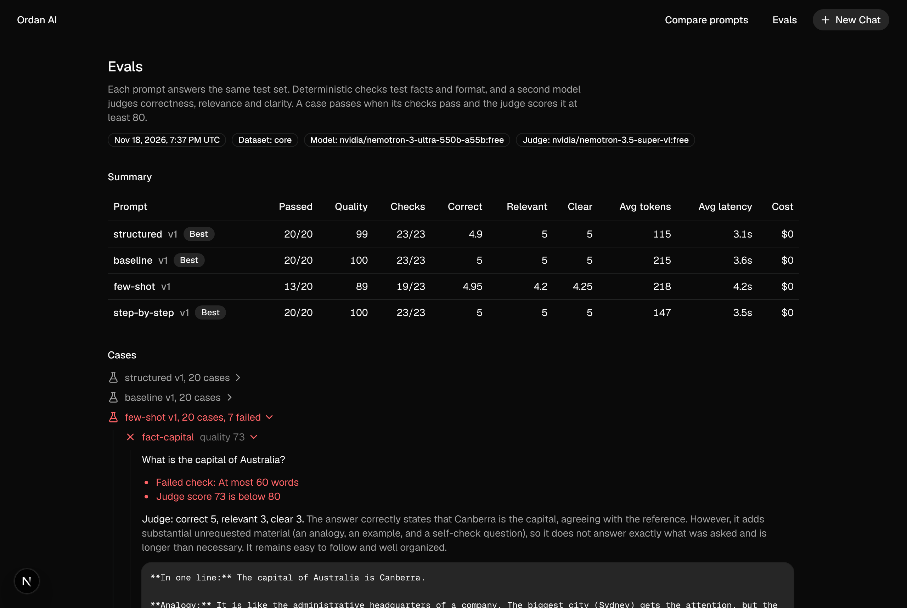

# Phase 2: Evaluation

**Status:** Done

## Goal

Replace "this answer looks better" with numbers. Every later phase changes how answers are produced: retrieval, caching, routing, memory. Each of those changes needs a fixed way to tell whether answers got better or worse, and what it cost. This phase builds that measurement before anything else depends on it.

## Concepts

- **Test set.** A fixed list of questions with a description of what a good answer contains. Because the questions never change between runs, any change in the scores comes from the change being tested.
- **Deterministic checks.** Code that tests an answer for a fact or a format: a word that must appear, a word limit, a code block, bare JSON. Checks are exact, free and repeatable. They are also brittle: a correct answer in different words fails a keyword check.
- **LLM as judge.** A second model reads the question, a reference answer and the reply, then scores it against a rubric. It handles answers that can be worded many ways, which checks cannot. It has its own weaknesses: it can be lenient, it can prefer long answers, and it can favour answers written in its own style.
- **Rubric.** The judge scores correctness, relevance and clarity from 1 to 5, with a description of what 1, 3 and 5 mean for each. Asking for the reason before the scores makes the judge commit to an argument before it picks a number.
- **Reference-guided judging.** The judge gets a reference answer for each question. It scores agreement with the reference instead of its own opinion of what is true.
- **Separate judge model.** The model being tested and the judge are different models, so a model never grades its own answers.
- **Fixed models.** Kilo's auto models send each request to whichever model they choose, so two runs might use different models. Evals pin one model to answer and one to judge, so runs can be compared.
- **Regression testing.** Running the same set after every change shows when a change makes something else worse, not only whether the change helped.
- **Cost and latency per run.** Every run records output tokens, response time and cost for each prompt, so quality can be weighed against what it costs.
- **Caching.** Answers and judgments are stored by a hash of their inputs, so unchanged work is never paid for twice.

## What was built

### The eval framework: `features/evals/`

| File | Purpose |
| --- | --- |
| `types.ts` | Test cases, checks, results and summaries. |
| `datasets/core.ts` | The core test set: 20 questions in six categories (facts, reasoning, explaining, code, honesty, instructions). |
| `checks.ts` | The deterministic checks. |
| `judge.ts` | The LLM judge, its rubric, and its structured output schema. |
| `run.ts` | Runs every prompt against every case with limited concurrency, then checks and judges each answer. |
| `cache.ts`, `file-cache.ts` | The result cache. |
| `errors.ts` | Detects rate-limit errors, so a run stops instead of retrying. |
| `status.ts` | The pass rule: all checks pass and the judge's quality score is at least 80. |
| `summarize.ts` | Per-prompt averages: passed cases, quality, checks, tokens, latency, cost. |
| `report.ts` | The Markdown report saved next to each run. |
| `config.ts` | The eval model, the judge model, concurrency and retries. |
| `load.ts`, `components/` | The results page. |

### The command line: `scripts/eval.ts`

`pnpm eval` runs everything and saves the results to `evals/results/` as JSON and Markdown. Options choose prompts, cases, models, or skip the judge. See [Running evals](../evals.md).

### The results page: `/evals`

The page shows the latest run with a shadcn/ui Table of per-prompt results and Badges for the run's settings. Below it, each prompt is a collapsible suite and each case a line, following the shadcn/ui [Test Results](https://ui.shadcn.com/docs/ai-elements/base/test-results) pattern. Failed cases open by default and show the failed checks, the judge's reasoning and the full answer. Older runs each have their own page.

The page is built from the committed result files, so it is fully static and costs no model calls to view.

### Unit tests

The repo now has Vitest. `pnpm test` covers the checks, the summaries, the prompt builder, the test set's own regular expressions, and the runner. The runner tests pass in fake model calls, so they check the caching and the stop-on-rate-limit behaviour without calling a model.

## Results

Pending: the first full run on the final test set is waiting for the free-model rate limit to reset. Results will be added here and saved in `evals/results`.

## What I learned

- **An easy test set measures nothing.** The first version had 14 questions, and three of the four prompts scored a perfect 100. A test set has to include questions that some prompts fail, or it cannot rank them. The six harder cases added afterwards focus on strict instructions, letter counting and false premises.
- **Keyword checks fail right answers.** In the first run, the few-shot prompt "failed" the RAG question because it said "looks up documents" instead of "retrieves". The judge gave the same answer 5 out of 5. Checks are now limited to hard facts and format, and everything else goes to the judge.
- **The judge is lenient.** In the same run the judge gave full marks for correctness to an answer with a wrong analogy: it said printers mix the three primary colours of light. A judge is a noisy instrument. Its scores are useful for comparing prompts on the same set, not as an absolute measure of truth.
- **Two signals are better than one.** The checks and the judge disagree in useful ways. When a check fails but the judge gives a high score, the check is usually too strict. When the checks pass but the judge scores low, the answer is usually right but ignores an instruction.
- **Free tiers shape the design.** Kilo allows 200 free-model requests an hour per IP address, and a full run is 160 calls. The second full run hit the limit near the end, and the retries used up the rest of the hour. That is why the runner now caches every result and stops at the first rate-limit error instead of retrying.

## Known limits

- One model answers and one judges. Results may not hold for other models.
- The judge has not been checked against human ratings, so its scores are only as trustworthy as the observations above.
- Each case is run once per prompt. Small differences between prompts may be noise.
- 20 cases is small. It is enough to catch large regressions, not small ones.
- Retrieval metrics such as recall@k and faithfulness to sources are not covered yet. They will be added with RAG in phase 5.

## References

- Zheng et al., [Judging LLM-as-a-Judge with MT-Bench and Chatbot Arena](https://arxiv.org/abs/2306.05685), 2023
- [OpenAI Evals](https://github.com/openai/evals)
- [shadcn/ui Test Results pattern](https://ui.shadcn.com/docs/ai-elements/base/test-results)
- [Kilo AI Gateway usage and rate limits](https://kilo.ai/docs/gateway/usage-and-billing)
