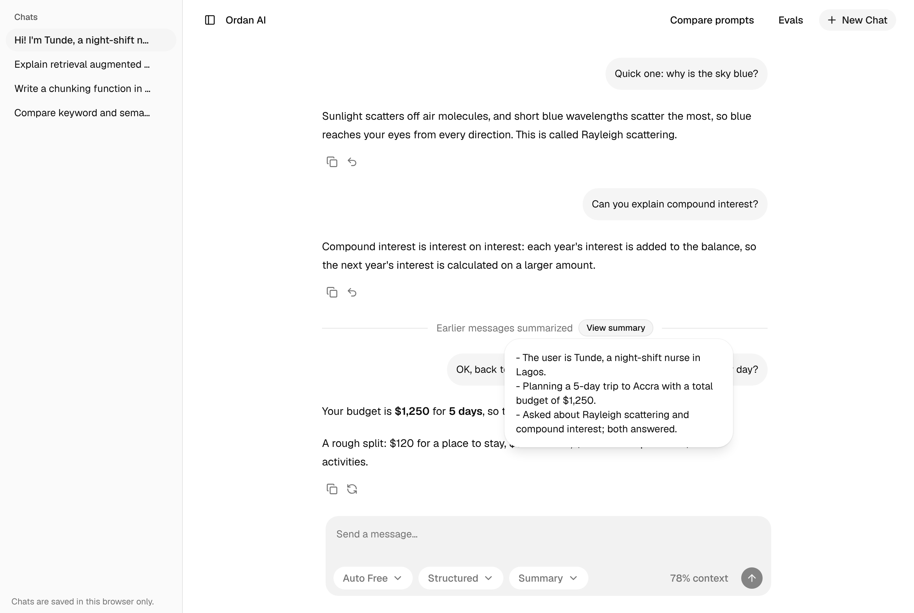
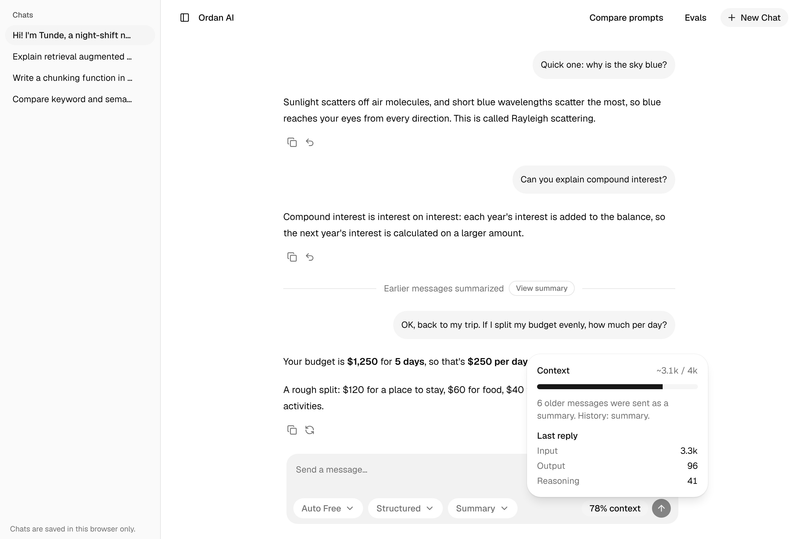

# Phase 3: Conversation history

**Status:** Done

## Goal

Make chats last, and make long chats affordable. Before this phase a chat disappeared on reload, and every message sent the whole conversation to the model again. A model does not remember earlier turns: the app has to send them every time. So each message costs more than the one before it, and a long enough chat eventually stops fitting in the model's context window. This phase saves chats, lists them, and adds three ways to fit the history into a token budget, with a measurement of what each one costs and what it forgets.

## Concepts

- **Statelessness.** A chat model keeps no memory between requests. The "conversation" is the list of messages the app sends with each request. Everything in this phase follows from that.
- **Context window.** The most tokens a model can read in one request: system prompt, history and the new message together. The models behind the gateway accept 128k tokens or more, but every token sent is paid for and makes the reply slower.
- **Token budget.** A limit the app sets for itself, below the real context window. Here it is 4,000 tokens (`HISTORY_BUDGET` in `features/history/config.ts`), small on purpose so trimming is easy to see. In a real product it is a cost decision.
- **Token estimation.** Deciding what to trim has to happen before the request, so the app estimates tokens at about four characters each. The provider reports the real count afterwards, and the Context indicator shows both. Real tokenizers come in phase 4.
- **Full history.** Send everything. Simple, and the model sees every detail, but input tokens grow with every turn, so the total cost of a chat grows with the square of its length.
- **Sliding window.** Send only the most recent turns that fit, and drop the rest. Cheap and predictable, but anything said before the window is gone: a name, a budget, an instruction like "always answer in British English".
- **Rolling summary.** When old turns no longer fit, a model call summarizes them, and the summary goes into the system prompt in their place. The next time turns leave the window, they are merged into the existing summary. It remembers the facts that matter at the cost of an extra call now and then.
- **Turns, not messages.** Trimming always removes a whole turn, a question with its answer, so the model never sees an answer without its question.
- **Hysteresis.** When the summary strategy has to make room, it trims down to 75% of the budget, not just under it. The slack means the next few messages fit without summarizing again on every turn.
- **Checkpoints.** A point in the chat you can go back to. Restoring one removes every message after it, like undo for a conversation.
- **Client-side persistence.** Chats are saved in the browser's localStorage. No server, database or account is needed, and chats never leave the device. The cost is that they do not follow you to another browser.

## What was built

### History: `features/history/`

| File | Purpose |
| --- | --- |
| `types.ts` | The strategies, the summary, and `ContextInfo`, which describes what was done with the history for a reply. |
| `config.ts` | The budget, the summary target and reserve, and the default strategy. |
| `tokens.ts` | Token estimates for text and messages. |
| `plan.ts` | Decides which turns to keep and which to evict. No model calls, fully unit tested. |
| `prompt.ts` | The summarizer's instructions, and how the summary or a "messages were removed" note is added to the system prompt. |
| `prepare.ts` | Plans, summarizes if needed, and returns the system prompt and messages to send. The summarizing call is passed in, so the chat and the evals share this code. |
| `summarize.ts` | The summarizing model call, through `lib/ai/provider.ts`. |
| `request.ts` | Validates the history settings the browser sends, and finds the latest summary in a chat. |
| `store.ts`, `use-saved-chats.ts` | Saving, listing and deleting chats in localStorage, and React hooks that keep every list in step, across tabs too. |
| `components/` | The chat list, the Context indicator and the Checkpoint marker. |

### How the summary travels

The server makes the summary, but it does not store anything. It sends the summary back with the reply as message metadata. The browser saves it with the chat and sends it with the next message, with the id of the last message it covers. The server only summarizes the turns after that id, so a summary is built once and extended, not rebuilt on every message. If that message is gone, because a checkpoint was restored, the summary is thrown away and rebuilt from the messages.

If the summarizing call fails, the reply is still sent, without the evicted turns, and the Context indicator says so. The next message tries to summarize them again.

### Changes to the chat

- **Saved chats.** A new chat gets the address `/chat/<id>` after its first message and is saved after every change. The sidebar lists saved chats, newest first, and each one can be deleted. Opening a chat restores its messages and its model, prompt and history settings. If storage is full, the chat says it was not saved.
- **History picker.** Next to the model and prompt pickers: Summary (the default), Window or Full.
- **Context indicator.** The shadcn/ui [Context](https://ui.shadcn.com/docs/ai-elements/base/context) pattern, a Hover Card with a Progress bar. It shows the estimated share of the budget the last request used, how many older messages were summarized or dropped, and the input, output and reasoning tokens the provider reported.
- **Checkpoints.** The shadcn/ui [Checkpoint](https://ui.shadcn.com/docs/ai-elements/base/checkpoint) pattern. A Marker shows where the model's view of the chat begins, with the summary one hover away. "Restore to here" on an earlier reply removes everything after it.
- **Layout.** The app now has a sidebar. On a phone it opens as a sheet from the header button, and the pickers wrap onto a second line.
- **Follow-ups** are no longer fetched again when a saved chat is opened, so opening a chat costs no model calls.

The new shadcn/ui components were added with the CLI: `sidebar`, `hover-card`, `progress` and `marker`.

### Evals

- Cases can now have a `history`, and the runner sends it through `prepareContext`, the same code as the chat. Summaries are cached like answers.
- `--history` and `--budget` choose the strategy and budget for a run, and the report records them.
- Reports now show average input tokens and, for the summary strategy, the tokens spent on summarizing.
- A new `history` test set: eight long conversations where the last question depends on something said in the opening turn (a name, a budget, an allergy, a running format instruction, a task list, a function, a time that was later corrected), plus a control case that needs only the latest turns. Its budget is 1,200 tokens, so the opening turns never fit.

### Tests

- Unit tests (`pnpm test`, 66 tests) cover the planner, the context preparation with fake summaries, the store with an in-memory storage, the request parsing, the token estimates, the runner with multi-turn cases, and the history test set's own checks.
- Browser tests (`pnpm test:e2e`) cover saving and reloading a chat, opening and deleting from the list, the summary marker and Context indicator, sending the summary back, and restoring a checkpoint. CI runs both.

## Results

All runs use `nvidia/nemotron-3-ultra-550b-a55b:free` to answer and `nvidia/nemotron-3.5-super-vl:free` to judge, with the `structured` prompt.

### The history test set: before and after

"Before" is the phase 0 to 2 behaviour: the full history.

| History | Passed | Quality | Checks | Avg input tokens | Avg summary tokens | Run |
| --- | --- | --- | --- | --- | --- | --- |
| Full (before) | 8/8 | 100 | 11/11 | 1,241 | – | [2026-11-19T20-00-40-088Z](../../evals/results/2026-11-19T20-00-40-088Z.md) |
| Window | 3/8 | 70 | 5/11 | 1,074 | – | [2026-11-19T20-03-46-765Z](../../evals/results/2026-11-19T20-03-46-765Z.md) |
| Summary | 8/8 | 100 | 11/11 | 679 | 1,181 | [2026-11-19T20-03-47-521Z](../../evals/results/2026-11-19T20-03-47-521Z.md) |

All runs cost $0, because the models are free.

What the numbers say:

- **The summary keeps what matters.** It passed every case with 45% fewer input tokens per answer than the full history (679 against 1,241). The summaries kept exact values: the $1,250 budget, all three tasks, the function's name and signature, the "Over and out." instruction.
- **The window forgets, but honestly.** It failed all five cases whose answer was only in the opening turn. The model did not make things up: it said "I don't have your budget or trip length in this conversation" and asked for it, which is the note in the system prompt doing its job. It passed the control case, the allergy case by luck (it suggested a banana), and the correction case, because the reply that confirmed the new time also repeated the day.
- **The window saves less than expected.** Only 13% fewer input tokens, because it keeps as much as fits, and these conversations are only a little over the budget. Its savings grow with the length of the chat.
- **A summary is not free.** Summarizing cost about 1,180 tokens per case, more than it saved on the one answer each case measures. It pays off over the following turns: the summary is made once and reused, while the full history is sent again in full every time.

### Over a long chat

The eval measures one answer per conversation. To see the cost over a whole chat, I simulated a 40-turn chat (40-word questions, 150-word answers) with the token estimator and the 4,000-token budget. These are estimates, not provider counts, and the summary calls are counted at their estimated size.

| History | Input tokens, all 40 turns | Summary calls | Total with summaries | Input tokens on turn 40 |
| --- | --- | --- | --- | --- |
| Full | 203,000 | 0 | 203,000 | 9,900 |
| Window | 124,000 | 0 | 124,000 | 3,800 |
| Summary | 112,000 | 5 | 124,000 | 3,500 |

The full history's cost per turn keeps climbing. The other two level off at the budget. Over 40 turns, summary and window cost the same, about 39% less than the full history, and the summary keeps the facts the window loses.

### The core test set: no regression

The history code changes nothing when a conversation fits the budget: the system prompt and messages are sent unchanged, which a unit test checks. The core set is single-turn, so it is a regression check: [2026-11-19T19-59-21-707Z](../../evals/results/2026-11-19T19-59-21-707Z.md).

| Prompt | Passed | Quality | Checks | Avg input tokens | Avg output tokens | Avg latency |
| --- | --- | --- | --- | --- | --- | --- |
| structured, phase 2 | 20/20 | 99 | 23/23 | – | 115 | 3.1s |
| structured, phase 3 | 20/20 | 100 | 23/23 | 239 | 117 | 2.5s |

Only the structured prompt was re-run, to stay inside the free tier's hourly limit. The other prompts' requests are unchanged.

## What I learned

- **Forgetting is the default.** The model remembers nothing. Every "memory" in a chat is a choice about what to send again, and every choice costs tokens or loses information.
- **The window strategy fails quietly in the product but honestly in the answer.** A user would only notice when the assistant asked for something they had already said. The one-line note in the system prompt is what turned a likely made-up answer into "I don't have that". Without it, the model sees a conversation that seems to start in the middle and has no reason to doubt it.
- **Summaries are compression with judgement.** The summarizing prompt decides what survives. Asking it to keep exact values and standing instructions mattered: the "end every answer with 'Over and out.'" case only passes because the summary kept the instruction word for word.
- **Hysteresis matters.** The first version trimmed to just under the budget, so once a chat was over it, every message would trigger a summary call. Trimming to 75% leaves room for several more turns before the next summary.
- **Sizing the reserve is a trade-off.** The first settings kept 400 tokens for the summary and trimmed to 60% of the budget. On the 1,200-token test set that left room for only the last message. A smaller reserve (300) and a higher target (75%) keep the last two turns.
- **Simulating is cheap.** Because the planner makes no model calls, a 40-turn chat can be simulated for free. That found a small bug: the window strategy's note was not counted against the budget, so a request could go about 15 tokens over. It is counted now.
- **The eval measures one turn.** The history test set scores the final answer only, so it shows what each strategy remembers but not the cost over a whole chat. That is why the simulation is reported next to it.

## Known limits

- Token counts before the request are estimates. They can be off by 20% or more for code or for languages other than English.
- Chats are stored in one browser. Clearing site data deletes them, and they do not sync between devices. A server-side store needs accounts, which is out of scope for now.
- The browser sends the summary back to the server, so a user could edit it. That is harmless here, because the user also sends the whole conversation, but it would matter once the history is shared or stored on a server.
- The budget is the same for every model. Kilo's auto models route to models with different context windows, so the budget cannot follow the real limit yet.
- Summarizing adds a model call before the reply starts, which delays the first token on those turns.
- The history test set has eight cases, and each was run once per strategy. It catches large differences, like five lost facts, not small ones.

## References

- Liu et al., [Lost in the Middle: How Language Models Use Long Contexts](https://arxiv.org/abs/2307.03172), 2023
- Packer et al., [MemGPT: Towards LLMs as Operating Systems](https://arxiv.org/abs/2310.08560), 2023
- [AI SDK: Message metadata](https://ai-sdk.dev/docs/ai-sdk-ui/message-metadata) and [chatbot message persistence](https://ai-sdk.dev/docs/ai-sdk-ui/chatbot-message-persistence)
- [shadcn/ui Context](https://ui.shadcn.com/docs/ai-elements/base/context) and [Checkpoint](https://ui.shadcn.com/docs/ai-elements/base/checkpoint) patterns
- [Next.js: window.history.replaceState](https://nextjs.org/docs/app/getting-started/linking-and-navigating#windowhistoryreplacestate)
