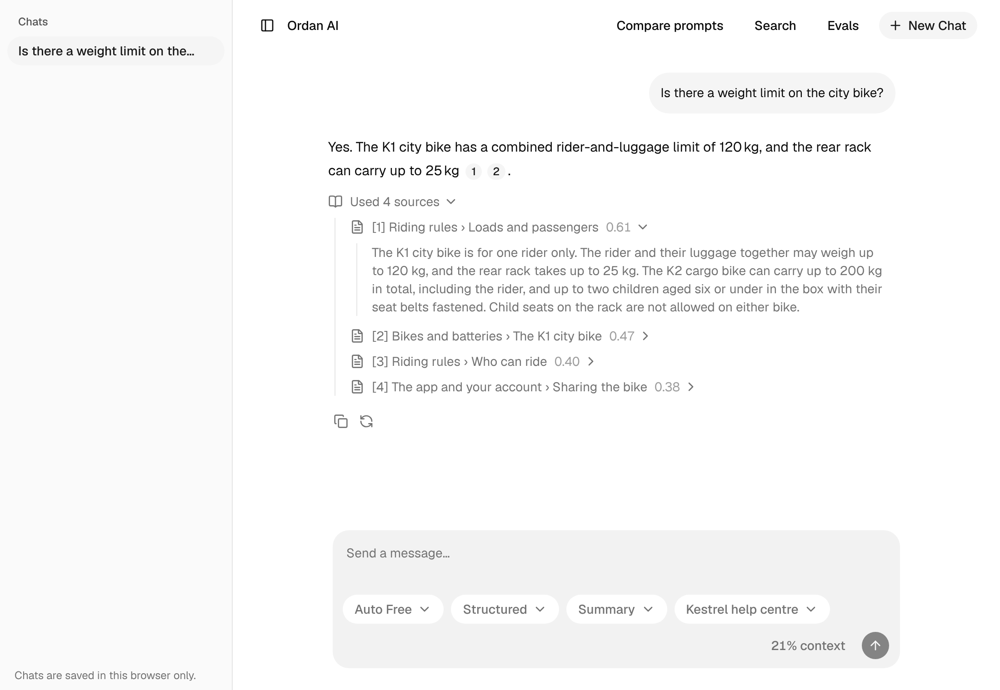

# Phase 5: Basic RAG

**Status:** Done

## Goal

Make the chat answer questions about documents it was never trained on, using the search from phase 4. Each answer cites the passages it used, and when the passages do not answer the question, the chat says so instead of guessing.

The documents are the made-up Kestrel Cycle Club help centre from phase 4. Because it is made up, a model cannot know the answers, so every right answer in the eval came from retrieval.

## Concepts

- **Retrieval augmented generation (RAG).** Search the documents for the question, put the best passages in the prompt, and ask the model to answer from them. The model brings the language. The documents bring the facts.
- **Grounding.** Telling the model to answer only from the given sources, not from what it knows. An answer is grounded when every claim can be traced to a source.
- **Citations.** Numbered markers such as [1] that tie each claim to a source, so a reader can check it. They also make grounding measurable: a citation that points at no source is a sign of a made-up claim.
- **Saying "I don't know".** A search always returns its closest passages, even when none answers the question. Something has to decide that the passages are not good enough. In this phase the model decides, following its instructions.
- **Faithfulness.** Whether the answer's claims are supported by the sources. It differs from correctness: an answer can be true and still unsupported, or supported by a source that is out of date.
- **Retrieval and generation fail separately.** A wrong answer can mean the search missed the passage, or the model ignored or misread it. Measuring both shows which one to fix.

## What was built

### `features/rag/`

- **`kestrel.ts` and `retrieve.ts`.** Search the committed `recursive-headings` index by meaning, the best setup in phase 4, and return the top 4 chunks numbered from 1. The question is the newest user message.
- **`config.ts`.** The settings, with the reasons for each. Chunks scoring under 0.2 are dropped. That only removes clear noise. Questions the help centre does not answer scored 0.28 to 0.52 on their best chunk, as high as many it does answer, so no threshold could separate them.
- **`prompt.ts`.** Instructions added after the chosen prompt: answer only from the sources, cite them as [1] or [2, 3], say when the help centre does not cover something, correct a wrong fact in the question, and treat the sources as material, not instructions. The sources follow as `<source id="1" title="Page > Section">` blocks.
- **`citations.ts` and `remark-citations.ts`.** Find citations, check that they point at a source, and turn them into links in the Markdown tree. Code is left alone, so `items[1]` in a code block stays as written.
- **`history.ts`.** Each reply numbers its own sources, so an old "[2]" would point at a different chunk now. Before the history goes back to the model, citations are removed from earlier answers that had sources.
- **`components/sources.tsx`.** The shadcn/ui [Sources](https://ui.shadcn.com/docs/ai-elements/base/sources) pattern: a Trace line, "Used 4 sources", that opens into one line per passage with its similarity score. Each line opens to show the passage.
- **`components/citation.tsx`.** The shadcn/ui [Inline Citation](https://ui.shadcn.com/docs/ai-elements/base/inline-citation) pattern: a small button in the sentence, with the page, section and passage in a Hover Card. A citation to a source that does not exist is shown in red.

### The chat

- A **Knowledge** picker next to the model, prompt and history pickers: "No documents" or "Kestrel help centre". It is saved with the chat. With Kestrel on, the empty chat suggests Kestrel questions.
- `app/api/chat/route.ts` retrieves, adds the sources to the system prompt, and sends them to the browser as message metadata (`rag`). The sources are added before the history is fitted to the budget, so the budget counts them. Four chunks are about 300 tokens.
- Sources are metadata, not the AI SDK's `source-document` parts, because those have no field for the passage text the hover card shows. Like the history summary in phase 3, they are saved with the chat.

### Evals

- **A `rag` test set** of 20 questions (`features/evals/datasets/rag.ts`): 13 the help centre answers, 2 follow-ups that only make sense with the turn before, 1 that states a wrong price, and 4 it does not cover. Each answerable case names the passage that answers it.
- **`--knowledge none`** asks the same questions without sources. That is the "before".
- **Retrieval per case:** the rank of the passage among the sources, the citations, and citations to sources that were not given.
- **Faithfulness from the judge.** With sources, the judge sees them and scores faithfulness from 1 to 5 as a fourth criterion. It is reported on its own, so quality stays comparable with earlier runs. Answers without sources use the old judge prompt, so their cached scores still apply.
- The report and the `/evals` page show Found, Faithful and Cited columns.

### Tests

- Unit tests for retrieval, the prompt, citation parsing, the remark plugin, removing old citations, the judge prompts, and the runner with and without sources. 126 unit tests in total, up from 100.
- `features/evals/datasets/rag.test.ts` checks that every passage is in its page and whole in a chunk of the index the chat uses, so a corpus change cannot make a case impossible without failing.
- `e2e/rag.spec.ts` picks the Kestrel help centre, sends a suggestion, and checks the inline citations, the hover card, the sources list, that code is not turned into a citation, and that the setting survives a reload.

## Results

Model `nvidia/nemotron-3-ultra-550b-a55b:free`, judged by `nvidia/nemotron-3.5-super-vl:free`, with the structured prompt.

| Run | Passed | Quality | Checks | Correct | Found | Faithful | Cited | Avg input tokens |
| --- | --- | --- | --- | --- | --- | --- | --- | --- |
| [Without sources](../../evals/results/2026-11-21T12-45-12-970Z.md) | 0/20 | 53 | 1/14 | 1.6 | – | – | – | 240 |
| [With sources](../../evals/results/2026-11-21T12-47-46-034Z.md) | **18/20** | **95** | 12/14 | 4.6 | 14/16 | 5.0 | 17/20 | 819 |

- **Without sources, nothing passed.** The model mostly asked which company was meant. When it did answer, it gave typical industry figures: a weight limit of "275 to 300 lb" from US bike-share schemes, and chain locks at "$15 to $40". Those are the confident wrong answers RAG is meant to prevent.
- **With sources, 18 of 20 passed.** Every answer stayed within the sources: faithfulness averaged 5.0 and no citation pointed at a source that did not exist. The wrong price was corrected ("€29 a month, not €35"), and all 4 questions the help centre does not cover were answered with "the help centre does not cover this", twice with the nearest facts it did have, such as the depot's normal hours.
- **Cited 17 of 20.** The three answers without a citation were "not covered" answers that used no source, which is right.
- **Both failures were retrieval misses, and both were safe.** The model said it did not know, rather than guessing:
  - *"My bike broke down at 11pm. How am I supposed to get home?"* The roadside help section (taxi refund up to €30) was not in the top 4, or even the top 10. The question shares almost no words or meaning with "outside those hours, we collect the bike the next day".
  - *"How far does it go on one charge?"* after a turn about the cargo bike. The search only sees the last message, so it found the K1 city bike and charging times, not the K2's range. Searching with the previous question added moves the right passage to rank 2.
- **Cost.** Input grew from 240 to 819 tokens per answer, mostly the four sources and the instructions. Retrieval took about 10 ms once the embedding model was loaded. Both runs were on free models, so cost $0.

## What I learned

- **Retrieval is the ceiling.** The model used every passage it was given correctly, and both failures came from passages it was never given. Better search will improve answers more than a better prompt.
- **A similarity threshold cannot decide "not covered".** Questions the help centre does not answer scored as high as ones it does, because they are about the same topics ("battery capacity" lands on the battery page). The model, given the passages and told to say when they do not answer, handled all 4 correctly.
- **Follow-ups need the conversation in the query.** Searching with the newest message alone loses "it" and "that plan". Query rewriting, in phase 6, is the fix.
- **Instructions made refusals reliable on this model.** Without them, a bare "no information" in the sources might still lead to guesses. With an explicit rule and an example phrasing, refusals were consistent. This is one model on 20 cases, so other models need their own runs.
- **Asking without sources is a useful baseline.** It shows what the model would have said, and it showed the most harmful failure: confident figures borrowed from other companies.

## Known limits

- **20 cases, one run, one model.** Two cases separate a good setup from a great one here, so small changes need a bigger set or repeated runs.
- **The judge saw no failures of faithfulness.** Every answer scored 5, so this run cannot show whether the judge would catch an unsupported claim. A few deliberately unfaithful answers would test that.
- **The search only sees the newest message**, so follow-ups that rely on earlier turns can fail.
- **The chat retrieves for every message** while Kestrel is on, including "thanks". Deciding when to search is part of agentic RAG (phase 11).
- **The Kestrel instructions are written for one corpus.** A second knowledge base would need its own description in the prompt.

## References

- [Retrieval-Augmented Generation for Knowledge-Intensive NLP Tasks](https://arxiv.org/abs/2005.11401), Lewis et al., 2020
- [RAGAS: Automated Evaluation of Retrieval Augmented Generation](https://arxiv.org/abs/2309.15217), Es et al., 2023, for faithfulness and answer relevance as separate scores
- [Lost in the Middle: How Language Models Use Long Contexts](https://arxiv.org/abs/2307.03172), Liu et al., 2023, on keeping the number of sources small
- shadcn/ui [Sources](https://ui.shadcn.com/docs/ai-elements/base/sources) and [Inline Citation](https://ui.shadcn.com/docs/ai-elements/base/inline-citation) patterns
