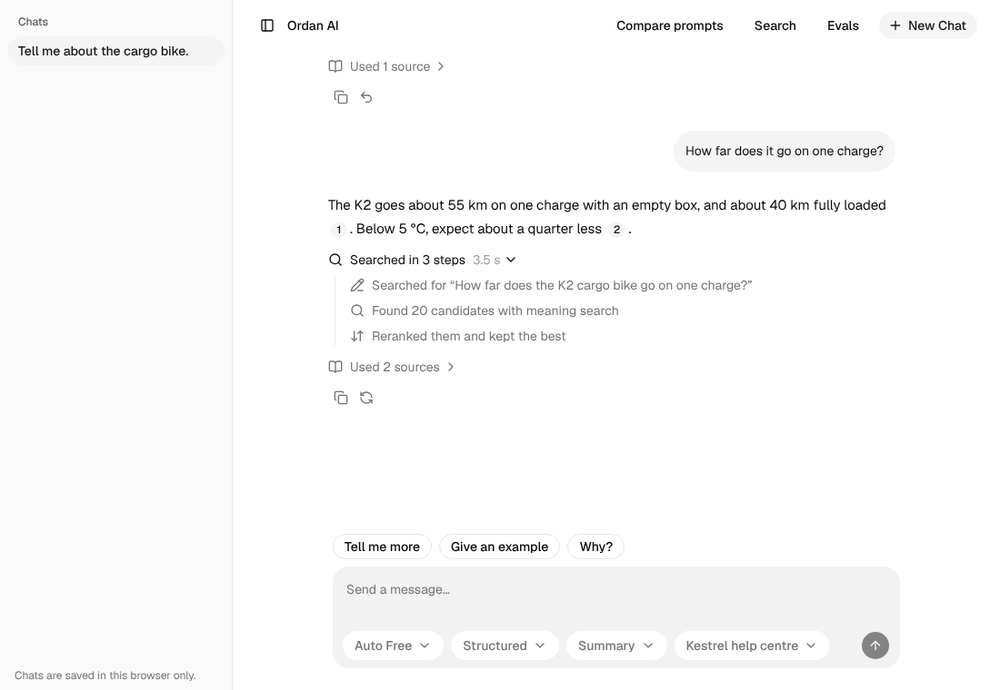

# Phase 6: Advanced RAG

**Status:** Done

## Goal

Phase 5 showed that retrieval is the limit: the model used every passage it was given correctly, and both failures came from passages it was never given. This phase improves what the search finds, and stops the chat searching for messages that need no documents.

## Scope

Decided before coding.

1. **Bigger test sets first.** Grow the retrieval set from 24 to 48 questions, with harder paraphrases and follow-ups that need the turn before, and grow the `rag` set from 20 to 32 cases, with small-talk messages that should not be searched. Run the eval on the current code for a "before".
2. **Query planning.** One model call reads the conversation and returns whether to search and a standalone question to search with. It covers two problems at once: follow-ups such as "how far does it go?" and messages such as "thanks".
3. **Query expansion.** HyDE (search with a made-up answer instead of the question) and multi-query (search with several rewordings and merge the lists), for questions worded far from the page.
4. **Hybrid search.** BM25 and vector rankings merged with reciprocal rank fusion.
5. **Reranking.** A local cross-encoder rescores the top 20 candidates, so the 4 sources are picked by a model that reads the question and the passage together.
6. **Measure every combination** with a new `pnpm eval:pipelines` (search and reranking are local; the planning and expansion calls are cached), then put the best one in the chat and measure answers with `pnpm eval --dataset rag`.
7. **Show the steps** in the chat with the shadcn/ui Chain of Thought pattern: the question it searched with, or why it did not search.

Out of scope: contextual retrieval (a model call per chunk to describe its context). The `recursive-headings` chunks already carry the page title and section heading, which is the cheap version of the same idea. It is in the backlog.

## Concepts

- **Query rewriting.** A follow-up such as "how far does it go?" means nothing to a search engine. A model that sees the conversation can rewrite it as "How far does the K2 cargo bike go on one charge?", which can be searched.
- **Deciding when to search.** "Thanks" or "put that in one sentence" asks for nothing new. Searching anyway costs time and tokens and puts unrelated passages in the prompt. The same model call that rewrites the question can decide this.
- **HyDE (hypothetical document embeddings).** Ask a model to write the passage that would answer the question, and search with that passage. An answer, even with made-up details, is worded more like the page than the question is.
- **Multi-query.** Ask a model for several rewordings of the question, search with each, and merge the lists, so one wording that matches the page is enough.
- **Hybrid search and reciprocal rank fusion.** Run keyword (BM25) and semantic search and merge the two rankings. Fusion adds 1 / (60 + rank) from each list, so it needs no tuning between scores on different scales.
- **Reranking with a cross-encoder.** The embedding model turns the question and each chunk into vectors separately and compares them. A cross-encoder reads the question and one chunk together and scores how well the chunk answers it. It is more accurate but runs once per chunk, so it only reorders the top candidates from the fast search.

## What was built

### `features/search/`

- **`fusion.ts`.** Reciprocal rank fusion.
- **`search.ts`.** A third method, `hybrid`, that fuses the semantic and keyword rankings of every chunk. `/search` shows it as a third column.
- **`rerank.ts`.** Reorders hits with a scoring function passed as an argument. `rerankScores` in `lib/ai/provider.ts` is the real one: `Xenova/ms-marco-MiniLM-L-6-v2`, a cross-encoder trained on search queries, about 90 MB, run locally with Transformers.js like the embedding model.

### `features/rag/`

- **`query.ts`.** The query planner, HyDE and multi-query. Each builds a prompt and reads the reply, and takes the model call as an argument. The planner replies in two lines, `SEARCH: yes|no` and `QUERY: ...`. A reply it cannot read means "search with the message as it is", the phase 5 behaviour, because a needless search costs a little while a skipped one can lose the answer.
- **`pipeline.ts`.** `runRetrieval` turns a conversation into sources with a set of `RetrievalSettings`: plan or not, expand with HyDE or multi-query or not, semantic or hybrid search, rerank or not. It returns the sources, the full ranking for the eval, and the steps it took.
- **`config.ts`.** `RAG_SETTINGS`, the settings the chat uses, with the reasons.
- **`prompt.ts`.** When the planner skips the search, the system prompt keeps the Kestrel rules and says no search was run, so a question skipped by mistake is still not answered from memory.
- **`components/retrieval-steps.tsx`.** The shadcn/ui [Chain of Thought](https://ui.shadcn.com/docs/ai-elements/base/chain-of-thought) pattern, built on Trace: "Searched in 3 steps" opens into what was searched for, how many candidates were found, and the rerank. A skipped search shows "No search needed", and the Sources line is hidden.
- **`eval/run.ts` and `scripts/eval-pipelines.ts`.** `pnpm eval:pipelines` runs 13 pipelines on the 48 retrieval questions and the 8 messages that need no search. Model replies are cached with their latency, so a run stopped by the rate limit resumes and a cached run still reports real latency.

### The chat

`app/api/chat/route.ts` sends the conversation to `retrieveKestrel`, which runs the pipeline with the chat's own model for the planner. A failed planner call falls back to searching with the message. The steps reach the browser in the `rag` metadata and are saved with the chat.

### Evals

- **Retrieval set:** 48 questions, up from 24: 13 harder paraphrases, 4 keyword questions and 7 follow-ups with the turns before them. Plus 8 messages that need no search.
- **RAG set:** 32 cases, up from 20: 6 harder paraphrases, 2 follow-ups and 4 small-talk messages.
- The eval runner retrieves through the same pipeline as the chat and caches the planner's calls under the same key as `pnpm eval:pipelines`. The report has a new Searched column.

### Tests

- Unit tests for fusion, hybrid search, reranking, the planner's prompt and parsing, HyDE and multi-query parsing, the pipeline with every setting, and the runner's cached retrieval calls. 149 unit tests, up from 126.
- `e2e/rag.spec.ts` checks the steps line and the "No search needed" case. `e2e/search.spec.ts` checks the hybrid column.

## Results

### Retrieval

`pnpm eval:pipelines` on the 48 retrieval questions, `recursive-headings` index. Recall@4 is the share of questions whose passage reaches the model, because the chat gives it 4 sources. Planning and expansion used `nvidia/nemotron-3-ultra-550b-a55b:free`.

The planner's prompt changed twice during the phase (see below), so the table names the run each row comes from. Rows without a planner are the same in every run.

| Pipeline | Run | Recall@1 | Recall@4 | MRR | MRR, paraphrased | MRR, keyword | MRR, follow-up | Model calls |
| --- | --- | --- | --- | --- | --- | --- | --- | --- |
| Semantic (phase 5) | all | 0.583 | 0.833 | 0.705 | 0.666 | 0.917 | 0.500 | 0 |
| Hybrid | [1](../../evals/retrieval/pipelines-2026-11-22T17-53-15-734Z.md) | 0.500 | 0.688 | 0.616 | 0.510 | 0.884 | 0.600 | 0 |
| Semantic + rerank | all | 0.729 | 0.896 | 0.805 | 0.791 | 0.958 | 0.600 | 0 |
| Hybrid + rerank | [1](../../evals/retrieval/pipelines-2026-11-22T17-53-15-734Z.md) | 0.708 | 0.896 | 0.787 | 0.751 | 0.958 | 0.643 | 0 |
| Plan | [3](../../evals/retrieval/pipelines-2026-11-22T18-24-12-017Z.md) | 0.625 | 0.896 | 0.757 | 0.666 | 0.917 | 0.857 | 1 |
| Plan + HyDE | [1](../../evals/retrieval/pipelines-2026-11-22T17-53-15-734Z.md) | 0.708 | 0.917 | 0.800 | 0.765 | 0.808 | 0.929 | 2 |
| Plan + multi-query | [1](../../evals/retrieval/pipelines-2026-11-22T17-53-15-734Z.md) | 0.688 | 0.917 | 0.800 | 0.739 | 0.875 | 0.929 | 2 |
| Plan + hybrid + rerank | [1](../../evals/retrieval/pipelines-2026-11-22T17-53-15-734Z.md) | 0.708 | 0.875 | 0.788 | 0.666 | 0.958 | 1.000 | 1 |
| Plan + multi-query + hybrid + rerank | [1](../../evals/retrieval/pipelines-2026-11-22T17-53-15-734Z.md) | 0.729 | 0.896 | 0.813 | 0.707 | 0.958 | 1.000 | 2 |
| **Plan + rerank (the chat)** | [3](../../evals/retrieval/pipelines-2026-11-22T18-24-12-017Z.md) | **0.792** | **0.958** | **0.863** | 0.791 | 0.958 | **1.000** | 1 |
| Plan + HyDE + rerank | [3](../../evals/retrieval/pipelines-2026-11-22T18-24-12-017Z.md) | 0.792 | 0.958 | 0.860 | 0.786 | 0.958 | 1.000 | 2 |
| Plan + rerank, fused with the search order | [4](../../evals/retrieval/pipelines-2026-11-22T18-28-58-571Z.md) | 0.688 | 0.958 | 0.817 | 0.749 | 0.958 | 0.857 | 1 |

- **Deciding when to search:** every planner skipped all 8 messages that need no search and never skipped one of the 48 questions.
- **Latency:** the planner call took 2.9 s at the median, HyDE about 5 s and multi-query 4.3 s, on the free model. Reranking 20 candidates took about 160 ms on the CPU, and semantic search about 10 ms.
- **The planner's three versions.** [Run 1](../../evals/retrieval/pipelines-2026-11-22T17-53-15-734Z.md): it fixed the follow-ups but also rewrote 8 of the 41 questions that already stood on their own, mostly by adding "Kestrel" ("Can my 15-year-old son ride a Kestrel electric bike?"), which pulled the reranker to the wrong chunks. [Run 2](../../evals/retrieval/pipelines-2026-11-22T17-58-53-825Z.md): told to copy such questions exactly, it changed none of them, but it also left "What if I only get round to it the day after tomorrow?" unresolved. Run 3 added three examples, written for the prompt and not taken from the test set. It changed none of the 41 and resolved all 7 follow-ups.
- **Still missed:** "Do you bring bikes to people living outside the city?" (no method finds "Millbrook or Saltmarsh"), and "What if I'm not in when the bike arrives?", which the reranker moved from rank 3 to 9.

### Answers

`pnpm eval --dataset rag`, model `nvidia/nemotron-3-ultra-550b-a55b:free`, judged by `nvidia/nemotron-3.5-super-vl:free`, structured prompt, 32 cases.

| Run | Passed | Quality | Checks | Correct | Found | Faithful | Cited | Searched | Avg input tokens |
| --- | --- | --- | --- | --- | --- | --- | --- | --- | --- |
| [Before: phase 5 retrieval](../../evals/results/2026-11-22T17-35-15-923Z.md) | 28/32 | 94 | 21/25 | 4.56 | 20/24 | 4.75 | 23/32 | 32/32 | 770 |
| [After: plan + rerank](../../evals/results/2026-11-22T18-24-12-948Z.md) | **30/32** | **97** | 24/25 | 4.72 | 22/24 | 4.94 | 26/32 | 28/32 | 799 |

By category, passed before → after: answerable 18 → 17 of 19, follow-ups 1 → 4 of 4, wrong fact 1 → 1, not covered 4 → 4, small talk 4 → 4.

- **Fixed (4):** all three follow-ups that failed before (the planner rewrote them, and each passage came back at rank 1), and "My bike broke down at 11pm", the phase 5 failure, which the reranker moved into the top 4.
- **Broken (2):** "Can you deliver my bike on a Sunday?" and "Can I swap the seat for a comfier one I already own?". Plain semantic search had their passages at ranks 4 and 3, and the reranker pushed them out: it preferred the depot's Sunday hours for the first, and it does not link "seat" with "saddle" for the second. Both answers then said the help centre did not say, rather than guessing, so the failures are safe ones.
- **Small talk:** all 4 passed before and after. The planner skipped all 4 searches, and the answers stayed short. Input tokens barely moved (524 → 533 for these cases), because the phase 5 threshold had already dropped almost every passage for them: only "thanks" got one source.
- **Cost.** The planner adds one model call before every answer, 2.9 s at the median here. Its own tokens, the instructions and up to 4 earlier turns, are not counted above. Answer input grew from 770 to 799 tokens on average. Both runs used free models, so they cost $0. The phase 6 runs made about 430 model calls, more than twice the free tier's hourly limit, and needed the cache to resume.

## What I learned

- **Reranking was the biggest single gain.** On its own it lifted MRR from 0.705 to 0.805 and recall@4 from 40 to 43 of 48, for 160 ms of local CPU and no model calls. But it is a second model with its own blind spots, and it broke 2 answers that plain search got right.
- **Follow-ups need the conversation, and one model call fixes them.** Follow-up MRR went from 0.50 to 1.00 with the planner and reranker. Nothing else helped follow-ups much, because every other technique still searched with "how far does it go?".
- **The planner must leave good questions alone.** The first version improved follow-ups but rewrote 8 standalone questions, and adding the company name to a question that is only ever about one company was enough to lower the reranker's ranking. A rewrite step should do as little as it can.
- **Hybrid search hurt on this corpus.** Keyword search finds the passage in the top 5 for only 58% of the questions, against 88% for semantic search, and equal-weight fusion lets the weaker list pull good passages down. The paraphrased questions, which are most of the set, are the ones it hurts.
- **HyDE and multi-query helped without a reranker and not with one.** Each lifted the planner's MRR from 0.746 to 0.800, but with the reranker HyDE scored 0.860 against 0.863 without it, for a second model call of 5 s. The reranker already does what they do: it reads the question and the passage together, so the wording gap matters less.
- **Deciding when to search was easy and saved little.** The planner skipped every message that needed no search and no real question. But the phase 5 similarity threshold was already removing most noise for small talk, so the skip saves a search, not tokens. The planner's cost, a model call before every answer, is paid for by the follow-ups, not by the small talk.
- **Fusing the reranker's order with the search's did not protect against its mistakes.** It lowered MRR from 0.863 to 0.817, because it also undid the reranker's good moves, which are far more common.

## Known limits

- **The planner was tuned on the test set.** Its prompt changed twice after reading its rewrites of these 48 questions. The examples added are not from the set, but a held-out set would show whether the gain carries over.
- **One model, one run each.** The chat's planner uses the chat's own model, which can be any of Kilo's auto models, and those were not measured. The answer runs are one run each, and 2 cases is within run-to-run noise.
- **Each answer waits for the planner.** About 3 seconds before the first token on the free model.
- **48 retrieval questions on 8 pages.** The reranker and hybrid results may differ on a larger corpus, or one with more exact codes and names, where keyword search is stronger.

## References

- [Precise Zero-Shot Dense Retrieval without Relevance Labels](https://arxiv.org/abs/2212.10496), Gao et al., 2022, for HyDE
- [Reciprocal Rank Fusion outperforms Condorcet and individual Rank Learning Methods](https://plg.uwaterloo.ca/~gvcormac/cormacksigir09-rrf.pdf), Cormack et al., 2009
- [Passage Re-ranking with BERT](https://arxiv.org/abs/1901.04085), Nogueira and Cho, 2019, for cross-encoder reranking on MS MARCO
- [Query Rewriting for Retrieval-Augmented Large Language Models](https://arxiv.org/abs/2305.14283), Ma et al., 2023
- [Introducing Contextual Retrieval](https://www.anthropic.com/news/contextual-retrieval), Anthropic, 2024, left for later
- shadcn/ui [Chain of Thought](https://ui.shadcn.com/docs/ai-elements/base/chain-of-thought) pattern
